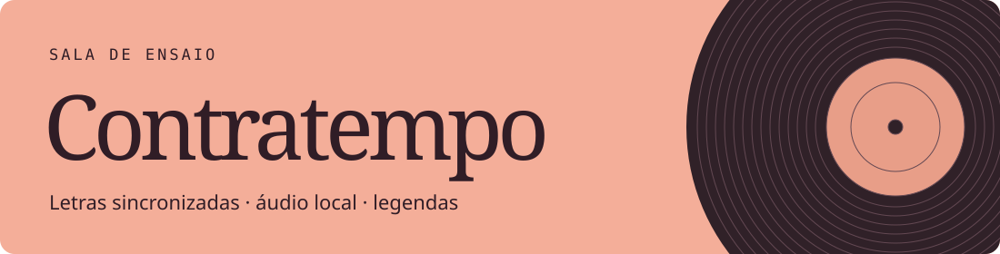

# Contratempo



Abra uma gravação, volte ao verso que escapou e ensaie de novo mais devagar. O **Contratempo** usa as marcações de tempo de um arquivo LRC para acompanhar uma música. No navegador, a própria gravação marca o tempo.

**[Tocar a demo de 12 segundos](https://ykauttiz.github.io/contratempo/)** · Letra e acompanhamento instrumental originais. Aperte play, escolha um verso ou reduza a velocidade para 0,75×.

## Ensaiar com a sua música

Baixe o repositório, abra o terminal na pasta e use Python 3.10 ou superior. No Windows, você também pode usar `py` no lugar de `python`.

```sh
python lyrics.py minha-letra.lrc --html ensaio.html
```

Abra **ensaio.html** e selecione a gravação em **Usar áudio local**. Pause, arraste a posição ou clique em um verso para voltar a ele. A página funciona offline e lê o áudio no próprio dispositivo. A precisão depende dos timestamps da sua letra.

## Usar a letra em vídeo

```sh
python lyrics.py minha-letra.lrc --vtt legendas.vtt
```

Cada legenda vai até a próxima marcação. Uma linha vazia indica silêncio. Se o último verso não tiver marca de fim, ele recebe três segundos. Os comandos de exportação criam arquivos novos e preservam os existentes.

## Acompanhar no terminal

```sh
python lyrics.py demo.lrc
```

O modo terminal tem relógio próprio. Inicie a gravação separadamente ou use `--start 45` para começar no segundo 45.

## Compartilhar no Discord

Com o Discord Desktop aberto e o compartilhamento de atividade habilitado, crie um aplicativo no [Developer Portal](https://discord.com/developers/applications), copie o **Application ID** e execute:

```sh
python -m pip install -r requirements-discord.txt
python lyrics.py demo.lrc --client-id SEU_APPLICATION_ID
```

O aplicativo usa Rich Presence local. O terminal acompanha cada linha e a presença envia no máximo uma atualização a cada 15 segundos. Use uma faixa mais longa para observar várias atualizações. A sessão termina no último timestamp. Adicione uma linha com o horário final em branco para manter o último verso até o fim da música.

## English quick start

Open the [live rehearsal demo](https://ykauttiz.github.io/contratempo/), or export your own offline rehearsal page with `python lyrics.py song.lrc --html practice.html`. Choose your audio file, slow it down, and select a line to seek. Export subtitles with `--vtt subtitles.vtt`. Run `python lyrics.py demo.lrc` for an offline, timed lyric preview. Start your audio separately. Use your own UTF-8 LRC file or add `--start SECONDS` to seek. Optional Discord desktop sharing uses an application ID. Personal account tokens are never required.

## Desenvolvimento

`python -m unittest -v` verifica timestamps repetidos, offset, linhas simultâneas, silêncio, retomada e intervalo de publicação. [Histórico](CHANGELOG.md) · [MIT](LICENSE)

## Como o código segue a música

Em um arquivo LRC, uma linha como `[00:03.00]A chuva ficou pra trás` diz que o verso começa no terceiro segundo. Em `lyrics.py`, a função `timeline` lê essas marcas, aplica o deslocamento global do arquivo e agrupa versos simultâneos. O modo terminal usa um relógio monotônico; o modo navegador consulta a posição do áudio.

Em `exports.py`, a mesma linha do tempo gera tanto a folha de ensaio quanto as legendas. A folha exportada contém a letra e o player; a gravação é escolhida no dispositivo. No modelo `rehearsal.html`, uma busca binária identifica o último verso iniciado sempre que o áudio muda de posição. A demo publicada em `docs/` inclui uma gravação curta para experimentar sem preparar arquivos.

Para reproduzir a verificação, execute `python -m unittest -v` na raiz. Uma das verificações compara a página publicada ao resultado de gerar a demo novamente. Para relatar um problema, inclua um trecho LRC fictício, o segundo em que ocorreu e o comportamento esperado.

## Legendas SubRip

Use `python lyrics.py demo.lrc --srt ensaio.srt` para gerar legendas numeradas em UTF-8. A conversão respeita as pausas da letra. Se o arquivo de destino já existir, o comando encerra sem sobrescrevê-lo.

## Tom do áudio

Ao mudar a velocidade, escolha se quer manter o tom original da gravação ou acompanhar a mudança de velocidade. O controle aparece em navegadores que oferecem esse recurso.
