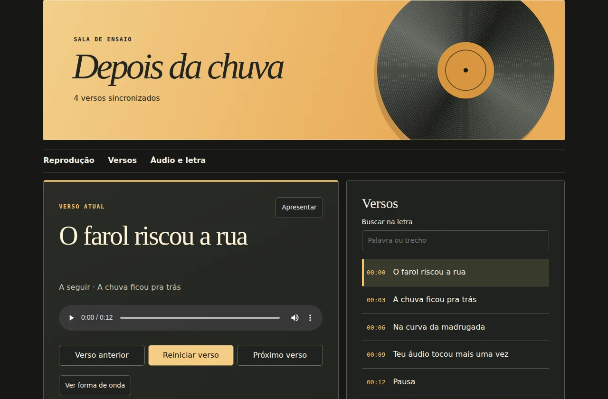

# Contratempo


Abra uma gravação, volte ao verso que escapou e ensaie de novo mais devagar. O **Contratempo** usa as marcações de tempo de um arquivo LRC para acompanhar uma música. No navegador, a própria gravação marca o tempo.

**[Abrir o Contratempo](https://ykauttiz.github.io/contratempo/)** · Letra e acompanhamento instrumental originais. Aperte play, escolha um verso ou reduza a velocidade para 0,75×.



## Ensaie direto no navegador

1. Abra a [sala de ensaio](https://ykauttiz.github.io/contratempo/) e toque a faixa de exemplo. Clique em um verso para ouvir a partir dele. Com o foco na lista, use ↑ e ↓ para escolher outro e Enter para ir até ele.
2. Em **Seu ensaio**, selecione ou arraste um áudio e a letra LRC em UTF-8. O navegador lê os arquivos no dispositivo. A demo acompanha a linha inteira.
3. Para praticar uma passagem, marque **A** no início e **B** no fim, com pelo menos 0,25 s de intervalo. Dê play para repetir. **Apresentar** amplia a letra; Esc volta ao ensaio.
4. Abra **Editar letra e sincronização**. Selecione um verso e marque seu início enquanto ouve. Para corrigir a letra inteira, edite os tempos ou informe um ajuste em milissegundos e clique em **Aplicar edição**. Por exemplo, +250 adianta cada marca em um quarto de segundo. Você pode desfazer e refazer as últimas 20 edições.
5. Escolha LRC para retomar a edição, SRT para um editor de vídeo ou WebVTT para um player web. Baixe o arquivo antes de fechar a página. O navegador exporta a versão aplicada.

Use **Ver forma de onda** para buscar visualmente em gravações de até cinco minutos e 16 MB. A prévia usa o primeiro canal do áudio; arquivos maiores continuam disponíveis no player. Em apresentação, ajuste o tamanho da letra com o controle deslizante.

Em **Guardar ou retomar sessão**, salve no navegador ou baixe o JSON para levar a outro aparelho. A sessão inclui letra, tempos, loop e velocidade. Escolha a mesma gravação ao reabrir.

O leitor aceita `[mm:ss]`, frações de um a três dígitos, várias marcas no início da mesma linha, pausas e `[offset:250]`. Tempos fora de ordem são ordenados; versos simultâneos são agrupados. O limite do importador web é de 1 MiB e 10 mil marcações. A reprodução depende dos codecs disponíveis no navegador.

## Gerar uma sala de ensaio offline

Baixe o repositório, abra o terminal na pasta e use Python 3.10 ou superior. No Windows, você também pode usar `py` no lugar de `python`.

```sh
python lyrics.py minha-letra.lrc --html ensaio.html
```

Abra **ensaio.html** e selecione a gravação em **Usar áudio local**. Pause, arraste a posição ou clique em um verso para voltar a ele. A página funciona offline e lê o áudio no próprio dispositivo. A precisão depende dos timestamps da sua letra.

## Usar a letra em vídeo

```sh
python lyrics.py minha-letra.lrc --vtt legendas.vtt
```

Cada legenda vai até a próxima marcação. Uma linha vazia indica silêncio. Se o último verso não tiver marca de fim, ele recebe três segundos. Os comandos de exportação criam arquivos novos e preservam os existentes.

## Acompanhar no terminal

```sh
python lyrics.py demo.lrc
```

Para escolher a duração do último verso sem uma marca de fim, acrescente `--last-duration 2.5` à exportação SRT ou WebVTT.

O modo terminal tem relógio próprio. Inicie a gravação separadamente ou use `--start 45` para começar no segundo 45.

## Compartilhar no Discord

Com o Discord Desktop aberto e o compartilhamento de atividade habilitado, crie um aplicativo no [Developer Portal](https://discord.com/developers/applications), copie o **Application ID** e execute:

```sh
python -m pip install -r requirements-discord.txt
python lyrics.py demo.lrc --client-id SEU_APPLICATION_ID
```

O aplicativo usa Rich Presence local. O terminal acompanha cada linha e a presença envia no máximo uma atualização a cada 15 segundos. Use uma faixa mais longa para observar várias atualizações. A sessão termina no último timestamp. Adicione uma linha com o horário final em branco para manter o último verso até o fim da música.

## English quick start

Open the [live rehearsal demo](https://ykauttiz.github.io/contratempo/), or export your own offline rehearsal page with `python lyrics.py song.lrc --html practice.html`. Choose your audio file, slow it down, and select a line to seek. Export subtitles with `--vtt subtitles.vtt`. Run `python lyrics.py demo.lrc` for an offline, timed lyric preview. Start your audio separately. Use your own UTF-8 LRC file or add `--start SECONDS` to seek. Optional Discord desktop sharing uses an application ID. Personal account tokens are never required.

## Desenvolvimento

`python -m unittest -v` verifica timestamps repetidos, offset, linhas simultâneas, silêncio, retomada e intervalo de publicação. [Histórico](CHANGELOG.md) · [MIT](LICENSE)

## Como o código segue a música

Em um arquivo LRC, uma linha como `[00:03.00]A chuva ficou pra trás` diz que o verso começa no terceiro segundo. Em `lrc.py`, a função `timeline` lê essas marcas, aplica o deslocamento global do arquivo e agrupa versos simultâneos. O modo terminal usa um relógio monotônico; o modo navegador consulta a posição do áudio.

O Contratempo trabalha com tempo **por verso**. No LRC estendido, as marcas de palavra, como `<00:12.50>`, são removidas da letra (no navegador e no Python) e só o tempo da linha vale; a sincronização palavra a palavra não é suportada e, ao salvar de novo, essas marcas não são preservadas. Texto comum entre `< >`, como `<3`, continua na letra.

Em `exports.py`, a mesma linha do tempo gera tanto a folha de ensaio quanto as legendas. A folha exportada contém a letra e o player; a gravação é escolhida no dispositivo. Em `web/player.js`, uma busca binária identifica o último verso iniciado sempre que o áudio muda de posição. A demo publicada em `docs/` inclui uma gravação curta para experimentar sem preparar arquivos.

Para reproduzir a verificação, execute `python -m unittest -v` na raiz. Uma das verificações compara a página publicada ao resultado de gerar a demo novamente. Para relatar um problema, inclua um trecho LRC fictício, o segundo em que ocorreu e o comportamento esperado.

## Legendas SubRip

Use `python lyrics.py demo.lrc --srt ensaio.srt` para gerar legendas numeradas em UTF-8. A conversão respeita as pausas da letra. Se o arquivo de destino já existir, o comando encerra sem sobrescrevê-lo.

## Tom do áudio

Ao mudar a velocidade, escolha se quer manter o tom original da gravação ou acompanhar a mudança de velocidade. O controle aparece em navegadores que oferecem esse recurso.

## Editar o site e verificar

A estrutura está em `rehearsal.html`, o estilo em `web/studio.css` e o player em `web/player.js`. O exportador incorpora tudo em um HTML portátil. Após uma alteração, rode `python build_demo.py` e `python -m unittest -v`. O teste de interface usa Playwright e Chromium, em larguras de 375 e 1280 pixels. Para reproduzir, instale `playwright==1.55.0`, execute `python -m playwright install chromium` e depois `python tests/browser.py`.

Selecione um verso e clique em **Repetir verso atual**. O player usa a marca do verso seguinte como fim. No último verso, usa o fim do áudio. Clique em play para ouvir e em **Limpar** para sair da repetição.

Busque palavras na fila de versos, inclusive sem acentos. As setas, Home e End percorrem os resultados visíveis enquanto o ensaio continua.

Use **Verso anterior**, **Reiniciar verso** e **Próximo verso** na mesa de reprodução. A busca cobre até 10 mil marcações e a fila exibe 60 por página. Home e End percorrem o conjunto filtrado inteiro. A lista completa de marcas para edição só é montada ao abrir o editor.

Guarde ensaios com nomes diferentes na biblioteca local. Cada entrada recupera letra, posição e ajustes. Selecione a gravação novamente ao abrir. Use a exportação JSON para manter uma cópia fora do navegador.

[Ver testes e capturas de celular e computador](https://github.com/ykauttiz/contratempo/actions/workflows/contratempo-tests.yml). Na execução, abra o artefato **capturas-chromium** ou **capturas-firefox**. As imagens usam dados fictícios.

Treino progressivo no loop A/B: escolha duas ou quatro voltas para avançar ao próximo nível de velocidade. O contador acompanha o trecho durante a reprodução.

## Publicar uma versão

Atualize `RELEASE.md` com as mudanças verificadas. Para marcar uma entrega, use na branch principal um commit com o título `release(vAAAA.MM.DD) Título da atualização`. Para uma segunda edição no mesmo dia, acrescente um número à versão, como `vAAAA.MM.DD.1`. O GitHub Actions publica a release após a aprovação dos testes. Commits comuns continuam atualizando o site.
